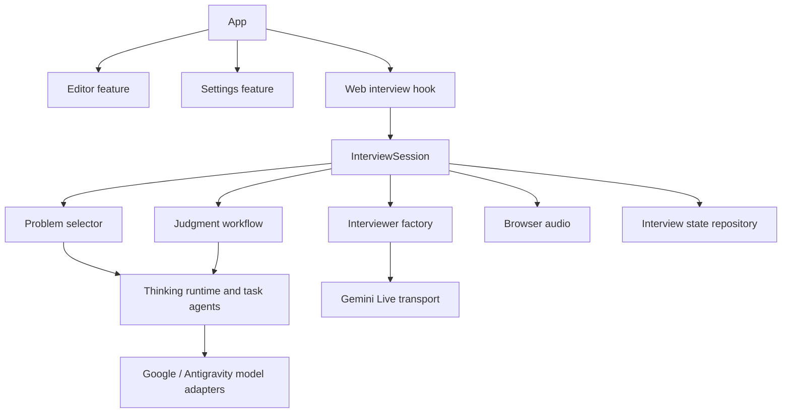

# Architecture

[Project overview](../README.md) · [Development](development.md) · [AI integration](ai-integration.md) · [Persistence and logging](persistence-and-logging.md)

## Composition and ownership

[index.ts](../index.ts) registers [App.tsx](../src/App.tsx), which composes the editor, interview, and settings feature exports. App passes code and language into grading, supplies formatted problem text to the workspace, and coordinates recovery and credential re-entry.

| Area | Responsibility |
| --- | --- |
| `features/editor` | Workspace presentation, CodeMirror/native inputs, language state, and document storage. |
| `features/settings` | Configuration drafts, validation, platform dialogs, preferences, and credential retention. |
| `interview/session` | Observable interview state, startup, transcript handling, resource lifetime, and recovery coordination. |
| `interview/selection` and `interview/judgment` | Problem acquisition and grading workflows, including domain validation and persistence policy. |
| `interview/agents`, `interview/llm`, and `interview/adapters` | Task prompts and agents; generic model contracts/runtime; library, provider, and browser integration. |
| `shared` | Cross-feature configuration, logging, and storage contracts. |

The web interview hook assembles the dependencies below. Arrows show dependency relationships; the Thinking node groups the shared runtime and task agents.

Cross-feature imports use feature `index.ts` exports; internal modules use direct imports to avoid barrel cycles. Import platform components and hooks without suffixes so Expo resolves `.web.ts(x)` or native implementations. Explicit web adapter imports belong in the web composition.

## Session controller and ports

[InterviewSession](../src/features/interview/session/InterviewSession.ts) exposes `getSnapshot` and `subscribe`. The React hook subscribes with `useSyncExternalStore`, keeping workflow state outside React components. Snapshots include connection status, problem, transcript, discussion, microphone state, recovery/storage status, and grading state.

[SessionDependencies](../src/features/interview/session/ports.ts) injects the problem selector, judgment workflow, discussion formatter, transport and audio factories, optional interview repository, clock, and logger. The controller owns startup deadlines and cancellation while delegating problem acquisition and individual grading phases.

Commands cover starting/retrying, sending text or discussion, microphone/audio activation, ending/retrying grading, recovery, disconnecting, and quitting. Disconnect stops resources and can leave an interview paused; quitting clears the active problem, transcript, discussion, and feedback. React cleanup uses `releaseResources` to preserve recovery intent across unmounts and Strict Mode cleanup.

Abort signals and attempt/request identifiers prevent superseded selection, connection, audio activation, and microphone permission results from updating the current interview. Transport and audio adapters close their own resources; late SDK connections are closed after cancellation.

## Workflow and data flow

The selector prepares a request with an initial status and a `getProblem(signal, logger)` operation. It either validates a random stored question or invokes the selection agent, then applies question-bank saving policy. Empty banks fail before allocating startup resources. Interviewer retries and recovery reuse the accepted problem.

The interviewer factory owns system instructions and opening/recovery messages. Its injected transport receives a prepared `LiveTransportRequest`, translating instructions, initial turns, and optional session resumption into SDK calls. Browser audio owns microphone capture, PCM encoding/decoding, playback scheduling, and interruption cleanup.

Ending an interview captures an immutable submission and stops Live resources. The judgment workflow obtains the Thinking model, assesses code then interview independently, publishes validated results, and retries only unfinished assessments against the original submission. Provider details and deadlines are covered in [AI integration](ai-integration.md).

## Workspace and platform boundaries

Workspace contains the problem as selectable text, discussion notes, and one code editor. Results becomes available when at least one assessment exists, including while the other assessment is running. Hiding Workspace preserves its mounted inputs and CodeMirror history. Quitting remounts the workspace and chat to discard drafts/history, clears code, and retains the selected language.

The browser editor creates one `EditorView` per mount. Compartments reconfigure language and read-only state without recreating it. Supported languages are JavaScript, TypeScript, Python, Java, and C++, with C++ as the default. Editor document persistence is controlled by interview recovery.

Native variants provide text inputs and settings with in-memory state. The native interview hook reports web availability and avoids importing browser adapters. Native bundle checks verify dependency resolution; device interaction is a separate check.

## Dependency boundaries

Provider adapters import generic model/transport contracts and shared configuration, not agent prompts or selection, judgment, or session policy. Generic Thinking contracts contain no domain imports. Selection and judgment each construct one shared LangChain agent implementation for both providers.

[Boundary tests](../tests/boundaries.test.cjs) enforce these rules, including the controller's delegation to selection and judgment. New provider work should extend the registry and factories while keeping task policy in the agent/workflow layers.
